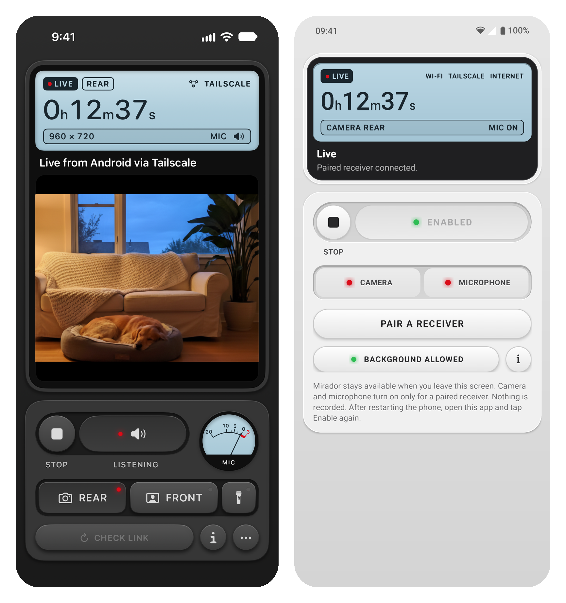

<h1>Mirador</h1>

Live camera and microphone from an Android phone to an iPhone.

<strong>Version 0.1.0</strong> · iPhone and Android

  
  
  
  

Mirador is a two-phone baby or pet monitor: the Android phone is the transmitter, and the iPhone is the receiver that plays its video and sound live. It doesn’t record or save anything.

- Choose the rear or front camera, zoom in, and turn listening on or off separately.
- Media goes straight between the phones over local Wi-Fi or Tailscale.
- An optional internet relay connects phones on different networks.

## Apps

The iPhone app is the receiver: SwiftUI, iOS 17 or later, native WebRTC ([details](ios/README.md)). The Android app is the transmitter: Java, Android 11 or later, a foreground service with a visible Stop button ([details](android/README.md)). The optional [relay](relay/README.md) is a small Cloudflare Worker.

## How it works

1. On the Android phone, tap Enable, then Pair a Receiver to show a private QR code.
2. On the iPhone, tap Pair Another Phone and scan it. You pair once.
3. Pick Rear or Front, and Listen if you want sound. In a dark room, the flashlight key turns on the Android phone's light. Stop ends everything.

Closing or backgrounding the iPhone app stops live input and does not resume on its own. After the Android phone restarts, tap Enable again.

## Privacy

The Android app asks for camera, microphone and notification permission, and to run without battery optimization. It opens the camera and microphone only for a paired iPhone. The iPhone app asks for camera access to scan the QR code and for local network access. The pairing secret stays in the iPhone's device-only keychain.

Control requests use certificate-pinned HTTPS, and video and audio use WebRTC. Through the relay, every request is also sealed with keys derived from the pairing secret, so the relay sees only a room ID and whether the sender is online. Relayed sessions use Cloudflare's STUN service, and Cloudflare TURN when you configure it. There are no analytics libraries.

## Limits

Mirador is a personal project, tested on one iPhone 17 Pro and one Nothing phone running Android 14. Android can still end the app. Reboot, overnight use, forced Doze and cellular-only use are untested. Only the Android phone keeps running in the background; the iPhone app stops when closed. The Android build is arm64 only.

## Install

There is no App Store, Play Store or release download. You build both apps yourself. You need an iPhone with iOS 17 or later, an Android phone with Android 11 or later (arm64), a Mac with a recent Xcode, JDK 17 and the Android SDK.

1. **iPhone:** create `local/Signing.local.xcconfig` with your Apple team ID and a bundle ID of your own, then run `ios/script/build.sh` or build in Xcode. Details are in the [iPhone README](ios/README.md#build). A free Apple account works, but its builds stop opening after 7 days.
2. **Android:** run `android/script/build.sh` and install the APK with `adb install -r`. Details are in the [Android README](android/README.md#build).
3. **Pair:** on Android, tap Enable, then Pair a Receiver; on the iPhone, tap Pair Android Phone and scan the code.
4. **Optional relay:** to watch from another network without Tailscale, deploy your own [relay](relay/README.md) and put its address in `local/relay.env` before building both apps. Otherwise, install Tailscale on both phones, or keep them on the same Wi-Fi.

Everything under `local/` (signing, relay address, pairing files, test reports and build caches) and `dist/` (personal builds) is ignored by Git and stays on your Mac. Mirador was called Android Viewer until October 2026, so the app identifiers keep the old name (`com.san.androidviewer`, `com.san.androidsender`); use your own bundle ID when you build the iPhone app.

---

[MIT](LICENSE). The Android robot in the app icon is reproduced or modified from work created and shared by Google and used according to terms described in the [Creative Commons 3.0 Attribution License](https://creativecommons.org/licenses/by/3.0/).

Made by [santiagoalonso.com](https://santiagoalonso.com)
